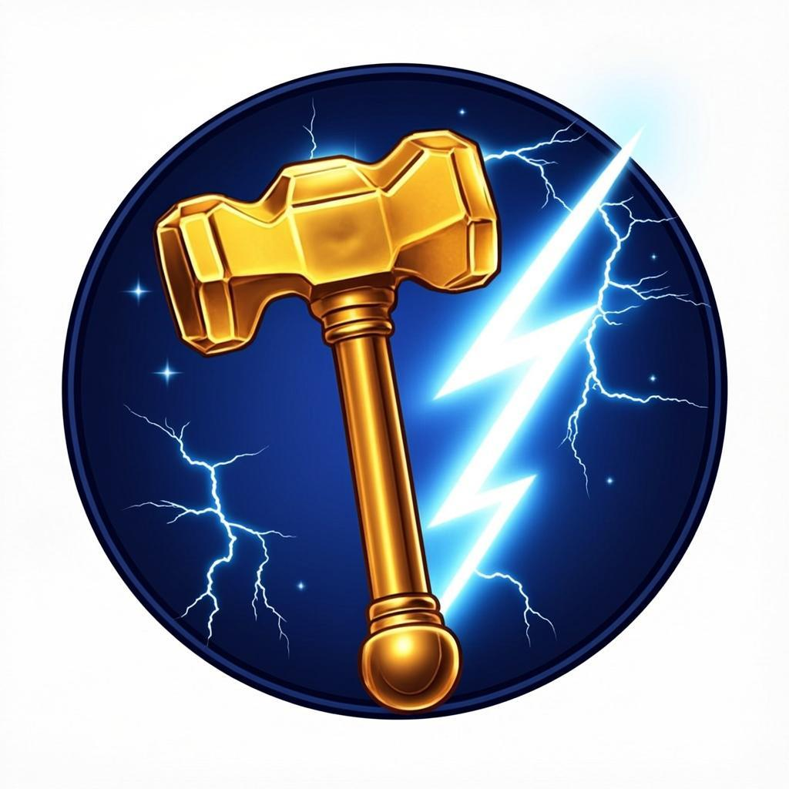

<p align="center">
  
</p>

<h1 align="center">⚡ THORHUB PANEL ⚡</h1>

<p align="center">
  <b>Panel hosting script pribadi ala Luarmor — milikmu sendiri</b><br/>
  Upload file <code>.lua</code> dari browser → loadstring otomatis → tambah game baru kapan saja.<br/>
  Dibangun dengan Next.js · siap deploy ke Vercel (gratis).
</p>

---

## 🎛️ Apa yang Panel Ini Bisa

- **Multi-script / multi-game** — setiap script punya loadstring sendiri; tambah game
  baru cukup dengan upload file `.lua`
- **Upload dari dashboard** — panel membuat commit otomatis ke repo ini
  (file script + manifest), lalu Vercel auto-redeploy ±1 menit → loadstring live
- **Status live otomatis** — kartu script menampilkan badge `aktif` / `menunggu deploy`
  (dicek tiap 12 detik)
- **Hapus script** — tombol sampah dengan konfirmasi + admin key
- **Mode manual** — tanpa env variable pun tetap bisa: unduh file hasil generate
  panel, upload manual lewat web GitHub
- **Fail-closed** — tanpa `ADMIN_KEY`, upload lewat panel otomatis dimatikan
  (siapa pun tidak bisa menulis ke repo-mu)

## 🚀 Cara Deploy ke Vercel (3 Menit)

1. **Buka [vercel.com](https://vercel.com)** dan login (bisa pakai akun GitHub).
2. Klik **"Add New → Project"**.
3. Pilih repo **`dwisetyabudi15581/ThorHub`** dari daftar (tekan **Import**).
   > Kalau repo tidak muncul: tekan **"Adjust GitHub App Permissions"** → beri akses ke repo ini.
4. Vercel mendeteksi **Next.js** otomatis — langsung tekan **"Deploy"**.
5. Setelah deploy, buka **Settings → Environment Variables** dan tambahkan:

| Variabel | Wajib? | Nilai |
|---|---|---|
| `GITHUB_TOKEN` | ✅ | PAT baru dengan scope `repo` (classic) atau *Contents: Read & Write* (fine-grained) |
| `ADMIN_KEY` | ✅ | kunci pilihanmu, mis. `petir-kunci-2026` |
| `GITHUB_REPO` | ⬜ | `dwisetyabudi15581/ThorHub` (sudah default) |
| `GITHUB_BRANCH` | ⬜ | `main` (sudah default) |

6. Tekan **Redeploy** — panel siap dipakai.

> 💡 Buat token GitHub **baru khusus panel**
> (`github.com → Settings → Developer settings → Personal access tokens`),
> jangan pakai ulang token yang pernah dibagikan di chat.

## ⚡ Loadstring Setelah Deploy

```lua
-- script utama (Steal an Egg)
loadstring(game:HttpGet("https://DOMAIN-KAMU.vercel.app/ThorHub.lua"))()

-- script lain yang kamu upload lewat panel
loadstring(game:HttpGet("https://DOMAIN-KAMU.vercel.app/scripts/nama-script.lua"))()
```

Website menampilkan loadstring **otomatis menyesuaikan domain** — tinggal tekan
Copy. File `.lua` disajikan dengan header `text/plain` bersih (diatur di
`vercel.json`) — kompatibel dengan Delta, Solara, Wave, Cryptic, dan executor
lain. Ada juga mode **GitHub Raw** sebagai URL cadangan.

## ➕ Menambah / Update Script (2 Cara)

**Cara A — lewat Panel** (butuh env di atas):
tekan **"+ Tambah Script"** → isi nama/game/versi → pilih file `.lua` → masukkan
Admin Key → **Upload & Commit**. Selesai — commit, redeploy, dan loadstring
terurus otomatis. Upload ulang dengan *slug sama* = update versi lama.

**Cara B — manual** (tanpa env):
1. Upload file `.lua` ke folder `public/scripts/` lewat web GitHub
   (*Add file → Upload files*)
2. Edit `src/data/scripts.json` — tambah satu entry untuk script itu
3. Commit → Vercel auto-redeploy ±1 menit

## 🔌 API Panel (opsional untuk integrasi)

| Method | Endpoint | Fungsi |
|---|---|---|
| `GET` | `/api/scripts` | daftar semua script (manifest) |
| `POST` | `/api/upload` | upload script baru (header `x-admin-key`) |
| `POST` | `/api/delete` | hapus script (header `x-admin-key`) |

## 📁 Isi Repo

```
public/
  ThorHub.lua              ← Script utama ThorHub — Steal an Egg (payload Luraph)
  scripts/                 ← Script hasil upload panel (auto-created)
  assets/logo.png          ← Logo ThorHub (Mjolnir + petir)
  assets/banner.png        ← Banner ThorHub
src/
  data/scripts.json        ← MANIFEST — daftar script yang tampil di panel
  app/page.tsx             ← Dashboard panel (Next.js + Tailwind)
  app/api/scripts/         ← GET manifest
  app/api/upload/          ← POST upload → commit ke repo ini (Git Data API)
  app/api/delete/          ← POST hapus script
  components/thorhub/      ← Dialog upload + seksi dokumentasi
  lib/github.ts            ← Helper GitHub API (server-only)
  lib/scripts.ts           ← Tipe & helper manifest
vercel.json                ← Header khusus file .lua + CORS
```

## 🛡️ Keamanan

- Token GitHub **hanya** hidup di Environment Variables Vercel (server-side),
  tidak pernah dikirim ke browser
- Upload tanpa `ADMIN_KEY` → ditolak otomatis (fail-closed)
- Script utama sudah diaudit penuh (3.044 string dianalisis): tanpa key system,
  tanpa tracking, hanya 3 kontak jaringan wajar
- Riwayat versi tersimpan rapi di git commit

## 💻 Menjalankan Secara Lokal (Opsional)

```bash
bun install     # atau: npm install
bun run dev     # atau: npm run dev
```

Buka `http://localhost:3000`. (Upload lewat panel butuh env vars — tanpa itu,
panel otomatis menawarkan mode manual.)

## 🛡️ Kenapa Vercel?

- **Gratis** untuk project pribadi (Hobby plan)
- **Tahan lama** — deployment terakhir tetap melayani file meski repo GitHub
  bermasalah; loadstring domain Vercel tetap hidup
- **Cepat di Indonesia** — CDN global, tidak kena blokir seperti
  `raw.githubusercontent.com` di sebagian ISP

## 🙏 Kredit

- Script asli: **Chilli Hub** oleh tienkhanh1 (script gratis komunitas)
- ThorHub: rebrand UI (judul window, logo, gradient) + audit keamanan penuh

⚠️ *Gunakan dengan bijak — penggunaan script pihak ketiga selalu membawa
risiko ban akun Roblox.*
